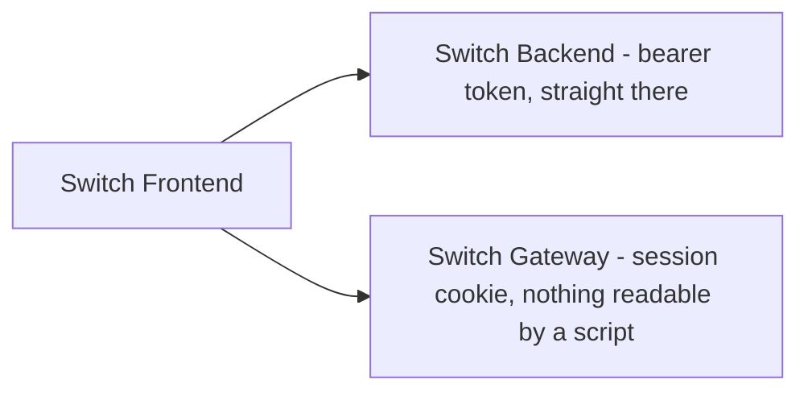

# Switch Frontend

## At a Glance

Every screen of the job search: the dashboard, applications, interviews and their rounds,
assignments, screening calls, the workflow timeline, and the profile. Next.js App Router, React
19, TypeScript, Tailwind - server components for the frame, client islands only where something
actually changes.



- **Switch Backend** - the only source of data; there is no mock layer and nothing that can drift out of step with the real endpoints
- **Switch Gateway** - used when the browser signed in through Keycloak; calls go through it and it attaches the token

## Security

- The sign-in panel has **no password field**. Signing in is a full navigation to Keycloak, and the app never sees the password
- Two credentials, one rule each: a session cookie this page cannot read (through the gateway), or - on the registration path, where no cookie exists yet - an access token in `localStorage`, sent straight to the backend. One request interceptor picks the address and the credential
- An error shown to a person never carries the backend's reason. The detail stays server-side; the screen says what to do next
- A 401 ends the session everywhere at once: credential cleared, mode reset, back to sign-in

## The Flows

- **Sign in** - leave for Keycloak -> come back to the gateway -> land in the app, which asks `/auth/session` who it is
- **Edit anything** - the form diffs itself and PATCHes only the fields that changed. Sending the whole record back would quietly overwrite anything that moved while the form was open
- **Lists** - 10 a page, server-ordered and server-paged. Delete the last row on the last page and the page guard walks back one instead of showing an empty table
- **Standalone interviews and assignments** - linked to an application, the company name comes from it; unlinked, the form asks for one, so nothing lands on the overview unnamed
- **Sample data** - one click fills an empty account through the ordinary API. Every date is an offset from today, so the dashboard's "this week" block is never stale

## The Screens

- `dashboard` - what needs attention this week
- `applications` - the list, the record, and its timeline
- `interviews` - interviews and their rounds, questions, feedback, rejection reasons
- `assignments`, `screening-calls` - take-homes and first calls
- `workflows` - one application's story, read from the trail the backend writes
- `profile` - the account, notification preferences, and deleting it

## Purpose

- The whole product surface. Everything a person sees of SWITCH is here
- Owns no data. The only thing it keeps between visits is which door was used to sign in - the credential itself is either the gateway's or the browser's, never this app's to interpret

**Talks to:**
- Switch Backend, Switch Gateway - see the diagram above

**Talked to by:**
- A browser, and nothing else

## Run it

```bash
npm install
npm run dev                  # http://localhost:3000
```

The backend has to be up first. For the cookie sign-in the gateway and Keycloak are needed too;
without them, create an account and the app works on a bearer token.
